# SupportSignal

Event-driven support triage and engineering escalation for a fictional B2B SaaS company.

SupportSignal receives customer conversations from Intercom, enriches them with account and system-health context, and decides whether each case should remain with Support, escalate to Engineering, or require human review.

The project demonstrates workflow automation, API integration, deterministic business rules, AI-assisted decisioning, structured handoffs, and operational reliability.

> **Portfolio disclaimer:** NovaSync, NovaTech, BrightDesk, ApexLabs, and all associated customer and operational data are fictional. No employer or Stackline-internal data is used.

## The problem

Support teams at growing SaaS companies often need to make escalation decisions with incomplete context. This can lead to:

- avoidable Engineering escalations;
- real incidents being missed or delayed;
- inconsistent decisions between support agents;
- technical handoffs without enough diagnostic information;
- limited visibility into why a routing decision was made.

SupportSignal turns that process into a repeatable workflow that combines customer impact, account context, live service health, deterministic rules, and confidence-based AI routing.

## System overview

```mermaid
flowchart LR
    IC[Intercom conversation] -->|conversation.user.created| WH[n8n webhook]
    WH --> EF[Conversation-event filter]
    EF --> GC[Fetch one conversation]
    GC --> NC[Normalize conversation]

    NC --> SF[Salesforce account context]
    NC --> SH[FastAPI system health]
    SF --> MC[Merge context]
    SH --> MC

    MC --> DR{Deterministic rules}
    DR -->|Clear incident| ENG[Engineering escalation]
    DR -->|Low-risk case| SUP[Support continues]
    DR -->|Ambiguous| JEV[Jev confidence routing]

    JEV --> ENG
    JEV --> SUP
    JEV --> HR[Human review]

    ENG --> AI[OpenAI technical handoff]
    AI --> JIRA[Jira issue]
    JIRA --> SLACK[Slack notification]
    SLACK --> INOTE[Intercom internal note]
    SUP --> SNOTE[Intercom support note]
    HR --> HNOTE[Intercom human-review note]
```



The production entry point is event-driven. A separate manual branch remains available for controlled debugging and scenario testing.

## Event-driven Intercom trigger

Intercom sends a `conversation.user.created` notification to an n8n webhook whenever a user starts or replies to a conversation.

The production branch:

1. receives the event at `POST /webhook/supportsignal/intercom`;
2. ignores Intercom verification `ping` events;
3. reads the conversation ID from `body.data.item.id`;
4. requests only that conversation from the Intercom API;
5. normalizes the response into the canonical shape expected by the existing pipeline;
6. rejoins the shared Salesforce and system-health enrichment flow.

Because n8n runs locally, a secure HTTPS tunnel forwards the public webhook URL to `localhost:5678`. The current development setup uses an authenticated ngrok domain. The domain and authentication token are intentionally not stored in this repository.

See [Architecture](docs/architecture.md) for the design decisions and trade-offs.

## Decision model

SupportSignal uses two decision layers:

1. **Deterministic rules** handle cases with clear operational signals, such as an active incident or an obviously low-risk request.
2. **Jev confidence routing** evaluates cases that remain ambiguous and selects Engineering, Support, or Human Review.

This keeps predictable decisions explainable while reserving probabilistic decisioning for cases where it adds value.

## Portfolio scenarios

| Scenario | Purpose | Expected route |
| --- | --- | --- |
| NovaTech | High-impact CRM synchronization problem | Engineering escalation |
| BrightDesk | Healthy authentication service and low customer risk | Support continues |
| ApexLabs | Insufficient or ambiguous evidence | Human review |

The scenarios use fictional business and system-health data. They can be exercised through the retained manual debugging path without changing the production webhook architecture.

## Components

| Component | Responsibility |
| --- | --- |
| Intercom | Receives customer conversations and emits webhook events |
| ngrok | Securely forwards public HTTPS webhook traffic to local n8n |
| n8n | Orchestrates integrations, normalization, decisions, and actions |
| Salesforce | Provides account tier, ARR, region, and customer context |
| FastAPI | Serves dynamic service-health and incident context |
| Jev / TypeSafe AI | Routes ambiguous cases using confidence-based decisions |
| OpenAI | Produces a structured technical handoff for Engineering |
| Jira | Creates the Engineering issue |
| Slack | Notifies the Engineering escalation channel |
| Intercom notes | Records the selected route for Support |
| Supabase | Planned decision audit log; not yet part of the active workflow |

## Reliability and security choices

- Webhook events replace polling and avoid downloading unrelated conversations.
- Intercom `ping` events are filtered before any conversation API request.
- External payloads are normalized before entering shared business logic.
- Deterministic rules run before AI-assisted routing.
- A manual trigger is retained for debugging without replacing the production entry point.
- Credentials are stored in n8n or local service configuration, never in workflow documentation.
- No API tokens, OAuth secrets, ngrok credentials, or customer data should be committed.

## Running the project locally

Prerequisites:

- Docker and a local n8n instance on `http://localhost:5678`;
- Python with FastAPI and Uvicorn;
- an ngrok account and reserved development domain;
- development credentials for the configured integrations.

Start the system-health API:

```bash
uvicorn api.main:app --reload
```

Start the HTTPS tunnel, replacing the placeholder with your own reserved domain:

```bash
ngrok http 5678 --url https://<your-ngrok-domain>
```

Configure Intercom to send `conversation.user.created` events to:

```text
https://<your-ngrok-domain>/webhook/supportsignal/intercom
```

Then publish the n8n workflow. External webhook events execute the published version; the manual trigger can execute the current editor version for debugging.

For the complete walkthrough, see the [Demo Guide](docs/demo-guide.md).

## Repository structure

```text
supportsignal/
├── api/                  # FastAPI system-health service
├── database/             # Planned persistence assets
├── docs/
│   ├── architecture.md   # Architecture and design decisions
│   └── demo-guide.md     # Demo runbook and troubleshooting
├── n8n/                  # Exported n8n workflow
├── .env.example          # Safe environment-variable template
└── README.md
```

## Project status

The event-driven Intercom trigger and the three routing scenarios are implemented and validated. Documentation and demo preparation are in progress. The Supabase decision audit log remains planned work.
