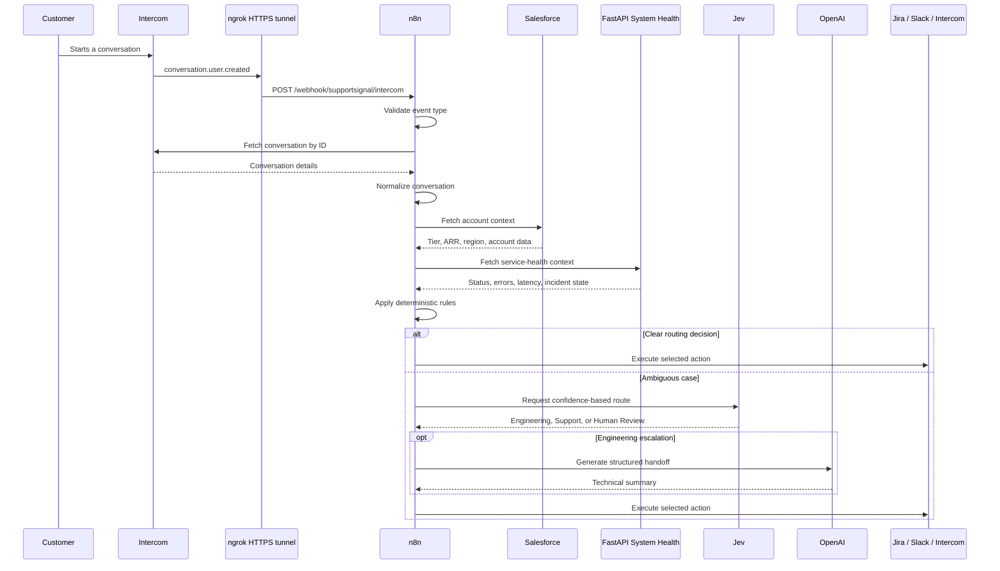

# SupportSignal Architecture

## Purpose

SupportSignal automates the first stage of support triage for a fictional B2B SaaS company. It combines customer context, service-health signals, deterministic business rules, and confidence-based AI routing to produce a consistent next action.

The system is designed as an orchestration workflow rather than a standalone application. n8n coordinates specialized services and keeps the decision path visible to operators.

## End-to-end flow



## Entry points

### Production: Intercom webhook

The production workflow starts with `Intercom New Conversation`.

- Method: `POST`
- Path: `/webhook/supportsignal/intercom`
- Subscription: `conversation.user.created`
- Conversation identifier: `body.data.item.id`

`Only Conversation Events` verifies that `body.data.item.type` equals `conversation`. Intercom verification events use another item type and stop at this filter without producing an error.

The workflow then fetches one conversation and normalizes it before any shared business logic runs.

### Debugging: manual scenario branch

The manual branch intentionally remains in the workflow. It supports repeatable testing of NovaTech, BrightDesk, and ApexLabs without requiring a new Intercom conversation for every development iteration.

This branch lists conversations, selects a known fictional scenario, and then joins the same enrichment and decision pipeline as the production branch. It is labeled as debugging functionality and is not the production trigger.

## Why an HTTPS tunnel is required

The local n8n instance listens on `localhost:5678`, which is reachable only from the developer's computer. Intercom must send events to a public HTTPS endpoint.

ngrok provides a secure forwarding layer:

```text
Intercom -> public HTTPS domain -> ngrok -> localhost:5678 -> n8n
```

A Cloudflare Quick Tunnel was used during initial validation. It proved the webhook architecture but generated an ephemeral URL. The final development setup uses an authenticated ngrok domain so the URL remains stable between tunnel sessions.

The domain is stable, but the local tunnel process must be restarted after the computer reboots. The ngrok authentication token and reserved domain configuration remain local and are not committed.

## Canonical conversation shape

Intercom webhook notifications and direct Intercom API responses have different structures. The `Normalize Intercom Conversation` node converts the fetched conversation into the structure expected by the existing pipeline.

Normalizing at the boundary prevents downstream nodes from depending on webhook-specific fields. Salesforce enrichment, service detection, system-health lookup, decision rules, Jev routing, and actions can therefore operate without separate implementations for manual and webhook executions.

## Decision layers

### Deterministic rules

Rules handle decisions that should be predictable and auditable. Examples include:

- an incident or clear high-impact technical signal routes to Engineering;
- a healthy service combined with low customer risk remains with Support.

### Confidence-based routing

Cases without a sufficiently clear deterministic result are sent to Jev / TypeSafe AI. The result is normalized into one of three routes:

- `ENGINEERING_ESCALATION`;
- `SUPPORT_CONTINUE`;
- `HUMAN_REVIEW`.

This design limits probabilistic decisioning to ambiguous cases and provides a safe human fallback.

## Downstream actions

### Engineering escalation

OpenAI produces a structured technical handoff. n8n then creates a Jira issue, sends a Slack notification, and records an internal Intercom note.

### Support continues

The workflow adds an Intercom note explaining that the case should remain with Support.

### Human review

The workflow adds an Intercom note indicating that the available evidence requires human review.

Supabase-based decision logging is part of the planned architecture but is not yet present in the active workflow.

## Key design decisions

| Decision | Reason |
| --- | --- |
| Webhook instead of polling | Lower latency and no unnecessary conversation downloads |
| Fetch by conversation ID | Limits processing to the event that triggered the workflow |
| Filter verification events | Prevents API calls with missing conversation IDs |
| Normalize at the boundary | Keeps downstream logic independent of Intercom payload shape |
| Deterministic rules before AI | Improves explainability and reduces unnecessary model usage |
| Human-review fallback | Avoids forcing a decision when confidence is insufficient |
| Retain manual trigger | Enables repeatable debugging and portfolio scenario testing |
| Stable tunnel domain | Avoids reconfiguring Intercom before every demo |

## Security boundaries

- Integration credentials are stored in n8n's credential store.
- The ngrok authentication token is stored only in local ngrok configuration.
- Exported workflows must be reviewed before being committed.
- Secret values must never be placed in `.env.example`, documentation, screenshots, or demo recordings.
- Only fictional portfolio data is used.

